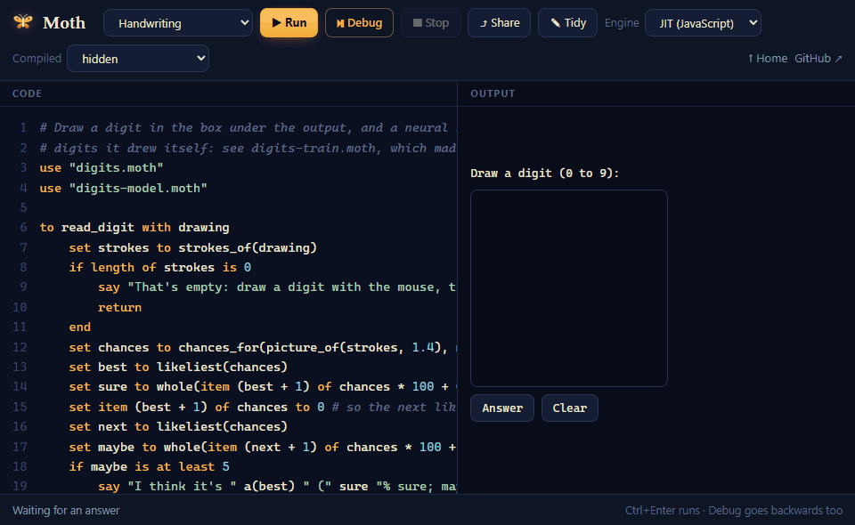
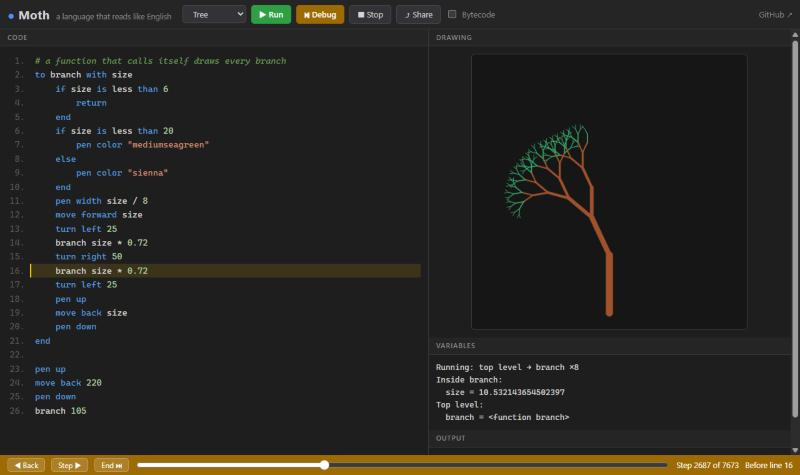
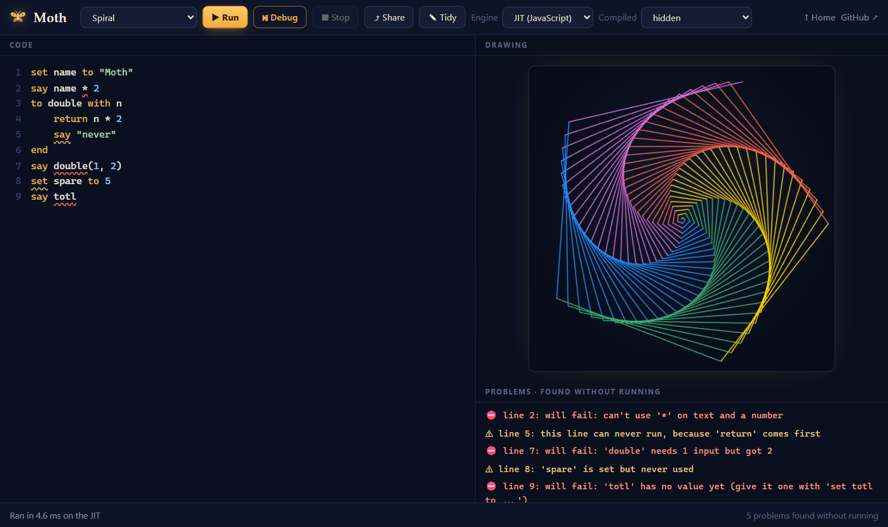
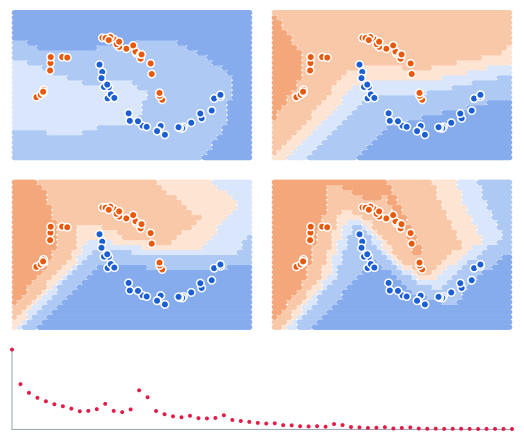
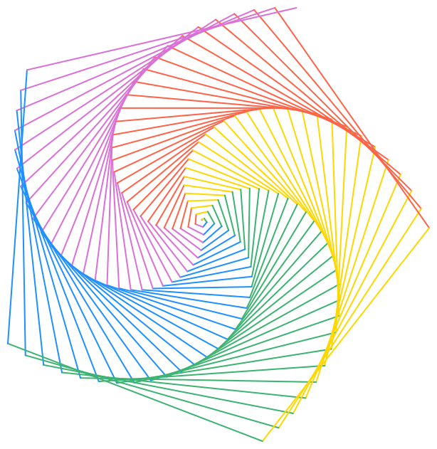

<div align="center">

<h1>Moth</h1>

<p><b>A programming language that reads like plain English.</b><br>
Written from scratch in JavaScript, with no dependencies.</p>

<p>
<a href="https://samyyy2423.github.io/moth/"><b>Open the playground</b></a>
&nbsp;·&nbsp;
<a href="#the-language">The language</a>
&nbsp;·&nbsp;
<a href="DESIGN.md">How it's built</a>
&nbsp;·&nbsp;
<a href="https://github.com/samyyy2423/moth/releases/tag/v1.7.0">Release 1.7</a>
</p>

<p>
<a href="https://github.com/samyyy2423/moth/actions/workflows/test.yml"></a>
<a href="https://github.com/samyyy2423/moth/releases/latest"></a>

<a href="LICENSE"></a>
</p>



<sub>A neural network written in Moth, reading digits drawn in the playground.</sub>

</div>

<br>

Moth reads the way you'd say it out loud. It's small enough to learn in an
afternoon, and built like a real language underneath: three engines that must
agree on every result, a compiler written in Moth itself, a debugger that runs
backwards, and neural networks written in it.

<table>
<tr>
<th width="58%">Moth</th>
<th>What it says</th>
</tr>
<tr>
<td valign="top">

```
set fruits to list of "apple", "pear"
add "mango" to fruits

for each fruit in fruits
    say "I like " fruit
end

to area with width and height
    return width * height
end
say "3 by 4 is " area(3, 4)
say item 5 of fruits
```

</td>
<td valign="top">

```text
I like apple
I like pear
I like mango
3 by 4 is 12

line 12: there is no item 5,
the list only has 3 items
```

</td>
</tr>
</table>

<table>
<tr>
<td width="50%" valign="top"></td>
<td width="50%" valign="top"></td>
</tr>
<tr>
<td valign="top"><b>A debugger that goes backwards.</b> It records the whole run, so a slider moves through it either way, showing every variable as it was.</td>
<td valign="top"><b>Mistakes found as you type.</b> Wavy lines mark code that will fail, in the same words as the error it would stop with.</td>
</tr>
</table>

## What makes it different

**Numbers and data the way people use them.** Arithmetic is shown and compared
like a spreadsheet, to 15 significant digits, so `0.1 + 0.2` is `0.3`. A number
can carry a unit, and Moth keeps the units straight. A CSV file is one line
away from a table you can filter, total and chart. And a program asks before it
touches your files or goes online.

<table>
<tr>
<th width="58%">Moth</th>
<th>What it says</th>
</tr>
<tr>
<td valign="top">

```
say 0.1 + 0.2 is 0.3
set trip to 5 km + 300 m
say trip " = " trip in miles
say 2 hours + 30 minutes in minutes

set sales to read table "sales.csv"
for each row in sales where price of row is greater than 10
    say name of row
end
say total of price in sales
draw chart of price in sales
say trip + 1 hour
```

</td>
<td valign="top">

```text
yes
5.3 km = 3.29326731885787 miles
150 minutes

Big, red melon
15.75
(a bar chart, saved as an SVG)

line 12: can't use '+' on
a distance and a time
```

</td>
</tr>
</table>

**Engines that agree.** Every program can run on a bytecode virtual machine, on
a JIT that compiles it to JavaScript, or as WebAssembly that Moth writes byte by
byte, and [`moth build`](#command-line) turns it into machine code: a program of
its own. All of them must say, draw and fail exactly alike, and thousands of
randomly broken programs check that they do on every push:

| `npm run bench` | VM | JIT | WebAssembly | Machine code |
|:--|--:|--:|--:|--:|
| fib(25), function calls | 64 ms | 11 ms | **6.1 ms** | 16 ms |
| a million-round loop | 60 ms | 8.1 ms | **5.4 ms** | 18 ms |
| primes up to 5,000 | 139 ms | 18 ms | **14 ms** | 36 ms |
| 200,000 records | 102 ms | 17 ms | **8.2 ms** | 32 ms |
| a million bytes, filled and summed | 422 ms | 90 ms | **40 ms** | 47 ms |
| 200,000 words counted in a dictionary | 102 ms | 32 ms | **23 ms** | 28 ms |

Machine code is timed from start to finish, starting up included; the others
inside a program that's already running.

**A compiler written in Moth.** [`compiler.moth`](compiler.moth) is 2,400
lines of Moth that compile any Moth program, itself included, to exactly the
JavaScript the JIT writes, byte for byte. Compiled by itself, it compiles itself
again, and again, to the same result, which `npm test` checks three stages deep.

**Machine code, from Moth alone.** [`machine.moth`](machine.moth) is a third
back end, written in Moth: it turns a program into a Windows `.exe` or a Linux
program, writing every x86-64 instruction and the file around them byte by
byte, with no assembler, linker or other compiler. So far it takes numbers,
yes, no and nothing, text, lists, records, dictionaries, bytes, variables,
`say`, `if`, the loops, functions (made inside functions and passed around as
values too), `try`, `read` and `write`, `ask`, `arguments`, and the helpers,
which is enough for [`math.moth`](math.moth) and the handwriting network. What
it makes does exactly what the JavaScript engine does, down to how a number is shown, how
two numbers compare to 15 digits, how text sorts, the calls a mistake lists,
and asking before it reads or writes a file, unless `--allow` flags given to
`moth build` let it:

```text
$ moth build fib.moth
compiled fib.moth to machine code for Windows -> fib.exe (50,176 bytes)
$ ./fib.exe
832040
```

Against C and Python, with the same four programs written in each
([`versus/`](versus)), every one timed from start to finish, it's about as fast
as C on three of them and 1.4 times as slow on function calls, and 10 to 210
times as fast as Python:

| `npm run versus` | C | Moth, machine code | JavaScript engine | Python |
|:--|--:|--:|--:|--:|
| fib(32): 7 million calls | 34 ms | 49 ms | 282 ms | 522 ms |
| adding 1 to 100,000,000 | 51 ms | 50 ms | 739 ms | 10.5 s |
| primes up to 300,000 | 86 ms | 85 ms | 260 ms | 2.0 s |
| 30,000,000 steps of decimal maths | 61 ms | 62 ms | 348 ms | 4.7 s |

On Windows 11, with MSVC's `cl /O2` and Python 3.13. Moth still keeps its
promises in these: numbers are decimals compared to 15 digits, and every step
that could go wrong is checked. machine.moth gets there by knowing, as it
writes the code, what each variable is sure to hold, and leaving out the
checks that can't fail; by keeping a loop's busiest variables in the
processor's registers; and by running a loop that only works out whole
numbers as 64-bit whole numbers, which goes back to decimals the moment a sum
gets too big to be exact.

**Is Moth standalone yet?** Yes. [`moth.moth`](moth.moth) is Moth's command
line, written in Moth: it reads a program and the files it uses, compiles it
with machine.moth and writes the program it makes. Made into machine code, it's
`moth.exe` (`moth` on Linux), which needs neither JavaScript nor Rust, nor any
other compiler, and builds itself into exactly the bytes Node.js built it into,
in about 4 seconds:

```text
$ moth build moth.moth --allow-read --allow-write --allow-run
compiled moth.moth to machine code for Windows -> moth.exe (11,426,816 bytes)
$ moth build tools/wordcount.moth --allow-read
compiled tools/wordcount.moth to machine code for Windows -> tools/wordcount.exe (90,112 bytes)
$ tools/wordcount.exe tools/story.txt 3
290 words, 107 different ones
the  ██████████████████████████████ 45
and  █████████████ 20
it   ███████ 11
```

It builds for the system it runs on, or the other one with `--target windows`
or `--target linux`, and a Linux moth.exe and a Windows one build each other
byte for byte too. The first one comes from Node.js
(`node bootstrap.mjs`) or from
[the releases](https://github.com/samyyy2423/moth/releases); after that, each
builds the next. It takes nearly all of Moth, units, tables, charts, drawing and
apps included. On Windows, a program that draws shows its picture in a window
when it ends, an app runs in one, and a question that starts with "Draw" opens a
pad to draw the answer on, so `moth build handwriting.moth` makes the
handwriting demo a program of its own.

**Neural networks, written in Moth.** [`neural.moth`](neural.moth) learns to
tell apart two moons of dots, after Andrej Karpathy's
[micrograd](https://github.com/karpathy/micrograd): every number it works out is
a record that remembers how it was made, so backpropagation can trace each
weight's share of the blame. Moth has no sine or `exp`, so
[`math.moth`](math.moth) writes them in Moth too, with random numbers that come
out the same every run. From 50% right to 100% in 60
steps:

<p align="center"></p>

<details>
<summary>Backpropagation, in Moth</summary>

```
for each i from 1 to count
    set v to item (count - i + 1) of order
    set g to grad of v
    set left to a of v
    if op of v is "+"
        set right to b of v
        set grad of left to grad of left + g
        set grad of right to grad of right + g
    else if op of v is "*"
        set right to b of v
        set grad of left to grad of left + data of right * g
        set grad of right to grad of right + data of left * g
    else if op of v is "relu" and data of v is greater than 0
        set grad of left to grad of left + g
    end
end
```

</details>

**It reads your handwriting.** The network at the top of this page learned
from digits Moth drew itself: there's no dataset.
[`digit-shapes.moth`](digit-shapes.moth) holds each digit as pen strokes and
bends them at random, [`digits.moth`](digits.moth) turns strokes into 16×16
pictures and runs the network, and [`digits-train.moth`](digits-train.moth)
trains it on 3,000 pictures in about 5 seconds, then writes what it learned as a
Moth file: 99% right on drawings it hadn't seen.

```bash
moth build digits-train.moth
digits-train > digits-model.moth
```

**Real tools.** [`tools/`](tools) holds programs that do real work with files,
bytes and dictionaries:

<p align="center"></p>

- [`picture.moth`](tools/picture.moth) draws the Mandelbrot set above and writes
  it as a BMP file, byte by byte, the header's numbers put together with bit
  operations.
- [`wordcount.moth`](tools/wordcount.moth) counts the words in any file:

  ```text
  $ moth build wordcount.moth --allow-read
  compiled wordcount.moth to machine code for Windows -> wordcount.exe (90,112 bytes)
  $ wordcount story.txt 4
  290 words, 107 different ones
  the   ██████████████████████████████ 45
  and   █████████████ 20
  it    ███████ 11
  moth  ██████ 10
  ```
- [`json.moth`](tools/json.moth) reads JSON into dictionaries and lists, `\u`
  escapes and emoji included, and [`json.test.moth`](tools/json.test.moth)
  tests it, with Moth's own test runner, on every push.

## The language

```
# comments start with #
set name to "Moth"                  # store a value
set fruits to list of "apple", "pear"
add "mango" to fruits               # add to a list, a number, or text
set item 1 of fruits to "kiwi"      # items are counted from 1

say "Hi, " name "!"                 # say joins the pieces exactly as written
say "I have " length of fruits " fruits"

if length of fruits is greater than 2
    say "lots of fruit"
else if fruits is empty list
    say "no fruit"
else
    say "some fruit"
end

repeat 3 times
    say "hip hip hooray"
end

set n to 1
repeat while n is less than 100
    set n to n * 2
end

for each fruit in fruits
    say fruit
end
for each i from 1 to 100
    if i is divisible by 7
        stop                        # leave the loop
    end
end

to area with width and height       # make a function
    return width * height
end
say "area: " area(3, 4)             # use it inside a value with brackets
to circle_area with r as a number   # an input can say what it is: each call checks
    return 3.14159 * r * r
end

to greet with person
    say "Hello, " person
end
greet "Sam"                         # or call it on its own line

set sam to record with name "Sam", age 20   # a record keeps named values together
set age of sam to 21
say name of sam " is " age of sam

to check_age with age
    if age is less than 0
        fail with "an age can't be below 0"  # stop with your own message
    end
end

set words to split "the quick fox" by " "   # text: split, join, uppercase, lowercase
say uppercase of item 2 of words " " join words with "-"
say position of "fox" in "the quick fox"    # 11: where it starts, or 0
set age to number of ask "How old are you?" # ask: the answer typed in, as text

use "math.moth"                     # another file's code: random numbers, sine, exp, sqrt

# drawing: the turtle starts in the middle, facing up, with its pen down
move forward 100                    # or: move back 50
turn right 90                       # or: turn left 45
pen color "tomato"                  # any CSS color name
pen width 3
pen up                              # move without drawing
pen down
```

For real programs: catching mistakes, dictionaries, modules, files, and bytes.

```
try                                         # catch a mistake and carry on
    set age to number of ask "Age?"
if it fails with why
    say "That's not a number: " why
end

set ages to dictionary where "Sam" is 20, "Ana" is 31   # look things up by key
set item "Bo" of ages to 7
remove "Ana" from ages
if "Sam" is in ages                         # is in: a list's items, a dictionary's keys, or text
    say item "Sam" of ages
end
for each person in ages                     # a dictionary's keys, in the order they were added
    say person ": " item person of ages
end

use "math.moth" as math                     # another file, its names kept apart as math's ...
say math's sqrt(2)

set notes to read "notes.txt"               # files: read, read bytes, write ... to
write uppercase of notes to "loud.txt"
remove the file "loud.txt"                  # there must be a file of that name
say read the folder "tools"                 # what's in a folder, in order: a folder's name ends in /
for each word in arguments                  # tool a b c, once moth build made tool
    say word
end

say "that went wrong" to the error output   # not the normal output: for what went wrong
set code to run program "git" with (list of "status")   # start a program, wait, and take its number
set answer to run program "git" with (list of "log") keeping its output
say code of answer " " length of output of answer " " mistakes of answer
if code is not 0
    stop the program with 1                 # end the whole program, with a number from 0 to 255
end

set block to 4 bytes                        # memory: bytes from 0 to 255
set byte 1 of block to 0xFF                 # numbers in hex and binary: 0xFF, 0b1010
say block                                   # (4 bytes: 255, 0, 0, 0)
say "hi" as bytes                           # (2 bytes: 104, 105); back again with: as text
say 12 bit and 10 " " shift 1 left by 4     # 8 16; also bit or, bit xor, shift right
say 255 as hex " " 5 as binary              # ff 101

to test_area                                # the test runner runs every function named test_...
    expect area(3, 4) is 12                 # and if it isn't so: expected 13 to be 12
end
```

For data: amounts with units, tables, and charts.

```
set trip to 5 km + 300 m                    # an amount: a number, then its unit
say trip in miles                           # 3.29326731885787 miles
say 3 * 2 hours " " 10 km / 4 " " 10 km / 2 km      # 6 hours 2.5 km 5
say 1 km is 1000 m                          # yes: amounts compare across units
add 700 m to trip
say number of (trip in m)                   # 6000: the number alone

set sales to read table "sales.csv"         # a CSV file: a list of records, one for each row
for each row in sales where price of row is greater than 10
    say name of row                         # the header names the fields, in lower case
end
say total of price in sales                 # also average of, largest of, smallest of;
say average of (list of 2, 4, nothing)      # 3: like a spreadsheet, empty cells are skipped
draw chart of price in sales                # a bar for each row
draw chart of (dictionary where "Mon" is 5, "Tue" is 7)     # the keys label the bars
set prices to read table "https://example.com/prices.csv"   # read can go online too
```

Time, order and saving:

```
say the time " on " the date                # 14:05:09 on 2026-10-30, where it runs
say the weekday                             # also: the year, the month, the day, the hour, the minute, the second
set start to the clock                      # seconds since the program started
wait 2 seconds                              # or: wait 500 milliseconds, wait n minutes
say the clock - start                       # about 2

say scores in order                         # a new list, smallest first; the old one stays as it was
say scores in reverse order                 # largest first
for each p in people in order by age        # records, by a field
    say name of p
end

save scores to "scores.txt"                 # any number, text, list, record or dictionary
set scores to load "scores.txt"             # and back again, as it was
```

Apps: pictures that answer keys, clicks and time.
[`apps/snake.moth`](apps/snake.moth) is a whole game in 110 lines, and
[`apps/paint.moth`](apps/paint.moth) a paint program in 54.

```
move to 50, -20                             # straight to a spot, drawing if the pen is down
draw box at 0, 0 size 40 by 20              # filled with the pen's color
draw circle at 0, 0 size 10
draw "Score: 3" at -200, 220 size 16
clear                                       # wipe the picture
say random number from 1 to 6               # a whole number, different each run

when a key is pressed with key              # "left", "space", "a", ...
    say "you pressed " key
end
when the mouse is clicked with x and y      # also: when the mouse is dragged
    draw circle at x, y size 5
end
every 100 milliseconds                      # or: every 2 seconds, every 1 minute
    move forward 1
end
```

- **Values:** numbers, amounts like `5 km`, `"text"`, `yes`, `no`, `nothing`,
  lists, records, dictionaries and bytes. Only `no` and `nothing` count as false.
- **Numbers** are worked out the computer's way, but shown, compared and used as
  whole numbers (an item's place, a count of times) to 15 significant digits,
  like a spreadsheet: `0.1 + 0.2` is `0.3`, and `item (0.1 * 30)` is item 3.
  Whole numbers up to 2^53 are always exact.
- **Units:** distances (`mm cm m km`, `inches feet yards miles`, and `metres`
  or `meters` written out), times (`milliseconds` to `weeks`), weights (`mg g
  kg`, `ounces pounds tonnes`, `grams` written out) and volumes (`ml`,
  `litres` or `liters`). A unit's word only counts as one after a number or
  after `in`, so it can still name a variable. Amounts of one measure add,
  subtract, compare and convert with `in`; they're times or over a number, and
  one over another of the same measure is a number. Mixing measures is a
  mistake, which says so.
- **Tables:** after `total of`, `average of`, `largest of`, `smallest of` and
  `draw chart of`, `price in sales` means each row's price; to convert a total,
  bracket it: `(total of trips) in miles`.
- **Inputs** can say what they are: `with name as text, age as a number` (also
  `yes or no`, `a list`, `a record`, `a dictionary`, `bytes`, `a function`), and
  each call checks them.
- **Comparisons:** `is`, `is not`, `is less than`, `is greater than`,
  `is at least`, `is at most`, `is divisible by`, `is in`, joined with `and`,
  `or`, `not`.
- **Maths:** `+ - * /`. Adding text to anything joins them into text.
- **Variables:** inside a function, `set` (or `add`, `for each`) changes a
  variable the top level, or an enclosing function, made above the function's
  `to` line; otherwise the variable is the function's own. A name a function
  only reads can be set anywhere around it, even below. Functions remember the
  variables around them.
- **Text:** any character but control characters; write `\n` for a new line and
  `\t` for a tab. Upper or lower case doesn't matter in names and words.

Mistakes get a message in plain words that points at the exact spot, with the
right name when you misspell one, the right word when you type a symbol from
another language, and the calls that led there:

```text
line 2: 'totl' has no value yet. Did you mean 'total'?
say "Total: " totl
              ^
line 1: I don't understand '>' (write 'is greater than')
if x > 5
     ^
line 6: can't divide by zero
    return total / length of numbers
                 ^
  in 'average', called from line 10
  in 'report', called from line 13
line 4: 'area' needs height to be a number, not text
say area(3, "4")
    ^
```

<p align="center">

&nbsp;&nbsp;

<br><sub>Drawn by the Spiral and Tree examples, in the playground.</sub>
</p>

## The playground

[The playground](https://samyyy2423.github.io/moth/) runs in any browser, with
nothing to install.

- **Run** works in a background thread, so **Stop** ends even a loop that never
  does. **Engine** picks the JIT, WebAssembly or the VM, and the status bar times
  each run, so you can race them.
- **Debug** records the run, then **Back**, **Step**, **End** and a slider move
  through it in either direction: the line about to run, the calls in progress,
  every variable in view, and the output and drawing as they were.
- **Problems** appear as you type. Click one to jump to it, and **Fix** puts a
  misspelled name, or a symbol from another language, right.
- **Compiled** shows what the code became: bytecode, the JIT's JavaScript, the
  JavaScript from the compiler written in Moth, or the WebAssembly module.
- **Share** puts the code in the link, and **Tidy** lays it out the one way
  Moth writes it (Undo brings it back).
- **Apps** keep running once they've set up: click the picture, and your keys,
  clicks and drags go to the program. Try **Snake** and **Paint**.
- **Examples** include **Handwriting** (draw on a pad), **Guess** (a
  number-guessing game that asks for answers), **Neural network**, and **Moth's
  own compiler**, running in your browser.

## Command line

`moth` is standalone Moth: a program of its own, with nothing else to install.
Get `moth-windows.exe` (save it as `moth.exe`) or `moth-linux` (save it as
`moth`, then `chmod +x moth`) from
[the releases](https://github.com/samyyy2423/moth/releases), or make it from the
source with Node.js: `node bootstrap.mjs`.

```text
moth build hello.moth                    compile it to machine code: hello.exe, or hello on Linux
moth run hello.moth Sam 3                build it beside itself, run it with those arguments, remove it again
moth tidy hello.moth                     write it the one way Moth writes code (--check only says which need it)
moth check hello.moth                    find problems in it without running it
moth test hello.test.moth                run every test_ function in it, each in a run of its own
moth test                                the same for every .test.moth file here and in the folders inside
moth build hello.moth --target linux     for the other system: --target linux or --target windows
moth build tool.moth --allow-read        let it read files without asking (also --allow-write, --allow-net, --allow-run, --allow-all)
moth build tool.moth --allow-read=data   only the files in data (also --allow-write=out, --allow-net=example.com)
moth build moth.moth --allow-read --allow-write --allow-run    moth, built by itself
```

`moth run` is `moth build` and then the program: it builds it into a file
beside the source (`hello-run.exe`, or `hello-run` on Linux), gives it
everything written after the file as its arguments and this terminal's own
input and output, waits for it, removes the file, and ends with the number the
program ended with. If a file of that name is already there, it leaves it
alone and runs nothing. The `--allow` flags go before the file, since what
comes after it is the program's own. `moth tidy` and `moth test` take any
number of files, and `moth test` with none finds every file ending in
`.test.moth` here and in the folders inside, but not hidden ones or
`node_modules`; `moth check` takes one.

`moth test` runs each test on its own, in a run of its own, so one test can't
spoil another: it builds the file once, then starts it once for each test, and
keeps what the test said to show under it if it fails.

```text
$ moth test tools/json.test.moth
✓ test_values
✓ test_lists_and_objects
✓ test_spaces_and_lines
✓ test_escapes
✓ test_mistakes
5 passed
```

A program moth makes asks before it reads a file, writes one, goes online, or
starts another program, the way Deno does: at a terminal you're asked, once for
each file, site or program (or `a` for all of them); anywhere else, such as in a
script, the answer is no unless it was built with `--allow-read`,
`--allow-write`, `--allow-net`, `--allow-run` or `--allow-all`. The first three
can name what they allow: `--allow-read=data,notes.txt` lets it read those files
and everything in those folders, wherever their links lead;
`--allow-net=example.com` that site. `use` only reads files in the program's own
folder, or folders inside it. A refusal is a mistake the program can catch with
`try`:

```text
$ moth build copy.moth
compiled copy.moth to machine code for Windows -> copy.exe (71,680 bytes)
$ copy
moth: let this program read 'notes.txt'? (y = yes, a = yes to all, n = no) n
copy.moth:1:20: can't read 'notes.txt': this program isn't allowed to read files (start it with --allow-read)
write uppercase of read "notes.txt" to "loud.txt"
                   ^
```

A program reads a site the way it reads a file, `read "https://example.com"`:
on Windows through WinHTTP, with the system's certificates, and on Linux through
the system's `curl`. A site that sends it on to another address is asked about
again there, ten moves at most; any other answer from 300 up is a mistake
(`can't read 'https://example.com/nothing': the site answered 404`), and a site
gets 60 seconds.

A mistake in a program, and what `moth` itself says went wrong, go to the error
output, so a program's own words stay clean; `moth` ends with 1 for a mistake,
2 when it doesn't understand what it was asked, and for `moth run` with
whatever the program ended with.

Until 1.5 Moth also had a command line written for Node.js, with a shell and
builds to JavaScript and web pages. Those went with the Rust engine; the
debugger and finding problems as you type are the playground's.

## Without JavaScript

The playground's engines are written in JavaScript, so a bug in JavaScript
itself could reach them. Standalone Moth has none: [`machine.moth`](machine.moth)
writes x86-64 machine code itself, every instruction and the file around it byte
by byte, with no assembler, linker or other compiler, and
[`moth.moth`](moth.moth), the command line, is written in Moth too. Made into
machine code by machine.moth, the two are `moth.exe`, and it builds itself:

```text
$ moth build moth.moth --allow-read --allow-write --allow-run
compiled moth.moth to machine code for Windows -> moth.exe (11,426,816 bytes)
```

That's the same 11,426,816 bytes Node.js made of it, and the moth.exe they make
makes them again. A Windows moth and a Linux one build each other byte for byte
too. What a program in machine code does is what the JavaScript engine does: on
every push, machine.test.js holds hundreds of programs to it, mistakes and all.
How it was built, from the first `say` to the garbage collector: **[DESIGN.md](DESIGN.md)**, §25.

Until 1.5 there was a second way: [`native/`](https://github.com/samyyy2423/moth/tree/v1.5.1/native),
Moth written again from scratch in Rust, which ran programs, built them into
machine code with `rustc`, and built compiler.moth with itself. Standalone Moth
does all of that without Rust, so it's gone.

## How it's built

```text
                                       ┌→ bytecode     → the VM        debugger, shell
                                       ├→ JavaScript   → V8            Run
source → tokens → syntax tree → scope ─┼→ WebAssembly  → V8            the fastest
                                       ├→ machine code → the CPU       moth build
                                       └→ checker      → problems      as you type
```

A tokenizer and a recursive-descent parser make a syntax tree whose every node
remembers where it came from, so errors can point at it. The scope rules give
each variable a slot, once, for every back end, so they can't disagree about
what a name means. Every check and error message lives in one place, `vm.js`,
which all three engines call. The compiler written in Moth repeats the first
four steps and the JIT, in Moth, and machine.moth uses its first four steps to
write machine code.

How each engine was made fast, what didn't work, and why: **[DESIGN.md](DESIGN.md)**.

<details>
<summary>The files</summary>

| File | What it is |
|:--|:--|
| [`moth.js`](moth.js) | Tokenizer, parser, bytecode compiler, and the public API (`run`, `check`, `compile`, `timeline`...) |
| [`scope.js`](scope.js) | Which variable each name means, shared by every back end |
| [`vm.js`](vm.js) | The virtual machine, and every check and error message all three engines use |
| [`jit.js`](jit.js) | The JIT: Moth to JavaScript |
| [`wasm-binary.js`](wasm-binary.js) | WebAssembly's binary format, written byte by byte |
| [`wasm.js`](wasm.js) | Moth to WebAssembly, with escape analysis and unboxed numbers |
| [`checker.js`](checker.js) | Finds mistakes without running the program |
| [`compiler.moth`](compiler.moth) | Moth's compiler, written in Moth |
| [`machine.moth`](machine.moth) | Moth to x86-64 machine code, written in Moth: a Windows .exe or a Linux program, byte by byte |
| [`moth.moth`](moth.moth) | Standalone Moth's command line, in Moth: with machine.moth, it is moth.exe, which builds itself |
| [`versus/`](versus) | The same four programs in Moth, C and Python, and `npm run versus`, which times them |
| [`neural.moth`](neural.moth), [`math.moth`](math.moth) | The neural network, and the maths it needs, in Moth |
| [`digits.moth`](digits.moth), [`digit-shapes.moth`](digit-shapes.moth), [`digits-train.moth`](digits-train.moth), [`handwriting.moth`](handwriting.moth) | Reading handwriting: strokes to pictures, the network, its training, and the program that asks you to draw |
| [`tools/`](tools) | Real tools in Moth: a picture maker, a word counter, a JSON reader and its tests |
| [`bootstrap.mjs`](bootstrap.mjs) | Makes the first moth.exe from the source, with Node.js |
| [`index.html`](index.html), [`worker.js`](worker.js) | The playground |

</details>

## Tested

`npm test` runs on every push. Tables of programs and mistakes run on all three
engines, and 5,000 randomly broken programs must make all three agree: the same
output, the same drawing, the same error at the same spot, and the same trail of
calls that led there.

<details>
<summary>Everything it checks</summary>

- every playground example, on all three engines
- programs with their exact output, and broken programs with their exact error
  messages and positions, on all three engines
- 5,000 randomly broken programs: each must fail with a proper Moth error, never
  a JavaScript crash, and the three engines must agree on all of them
- 1,500 new programs made from the grammar ([`generate.js`](generate.js)), every
  feature mixed in: the engines must agree, files and trails included, the
  compiler written in Moth must match the JIT, tidying must change nothing they
  do, and the checker must raise no false alarms. Run for longer, it found the
  `else` / `if` bug
- the checker against reality, on 3,000 more: no line it says will fail ever
  runs in a program that finishes, and it predicts 44% of runtime errors with
  no false alarms
- the compiler written in Moth against the JIT, byte for byte, on every example,
  every table program and 3,000 broken ones, and bootstrapping it three stages deep
- the neural network and the handwriting reader, on all three engines
- `stop`, the text helpers, `ask` and `use`, including that `ask` never asks
  twice when a run is handed over, and that a mistake in a used file names it
- `try`, dictionaries, bytes and bits, files and arguments (a run handed over
  reads the same files and writes nothing twice), and modules, whose names stay
  apart even where a function's own names hide them
- WebAssembly's own fast paths for bytes, bits and dictionaries, right at their
  edges (2^31, a shift by 21 or 22, -0, 255 and 256), against the other engines
- `expect` and the test runner, including that each test starts afresh; tidying
  every Moth file here (already tidy) and 2,000 broken programs (each tidied
  without changing a piece, and tidy the second time); and the three tools,
  whose pictures must match byte for byte on every engine
- the WebAssembly encoder against the spec's examples, and the playground's script
- machine code against the JavaScript engine: 400 random programs made
  from the part of Moth it takes ([`machine-programs.js`](machine-programs.js)),
  with awkward numbers, every comparison and mistakes on purpose, 120 written for
  what's easy to get wrong, and every test program and 300 broken ones it can
  take, each built for the system the tests run on, which must print, fail and
  exit exactly alike; machine.moth and moth.exe each building themselves into
  the same bytes; every character's upper and lower case; programs that make
  far more than they keep; a tool's files, arguments, answers and `--allow`
  flags against what `moth run` did; amounts, tables and folders read from real
  files, against the JavaScript engine reading the same files from memory; and
  charts and `rgb()` and `hsl()` colours, pixel by pixel in the picture the
  window draws
- the commands moth.exe has: a program it builds that starts another program,
  waits for it and removes a file, and one that keeps what another said, from
  both its outputs, more of it than a pipe holds; `moth run` passing arguments,
  input, output and the number a program ended with through, and leaving
  nothing behind; `moth tidy` on every Moth file here and on programs broken on
  purpose, each tidied to exactly the bytes `format()` makes; `moth check`
  against the checker, its own problems word for word; `moth test` on the
  tests in Moth here, said exactly as `test()` says them; and `moth test` on
  its own, finding the tests in a folder in the order the Node.js command line
  found them
- going online in machine code, against a server of the tests' own on
  127.0.0.1: a page's text and bytes, moves to other addresses, the answers
  that are mistakes, a refused connection, a big page and the `--allow-net`
  rules, in the Rust engine's words; and that a program that never reads is
  the same bytes it was

The tests are tested too: bugs planted on purpose in the VM, the JIT, the
checker, the compiler written in Moth, the neural network and WebAssembly's
unboxed numbers were all caught, some only by the fuzzer.

</details>

## Limits

- A program learns about the world through `ask`, its files, the sites it
  reads, its arguments, the clock, and in an app, keys, clicks and timers. In
  the playground, files last for one run, only sites that let any page read
  them can be read, and answering a question runs the program again from the
  start, so a `wait` before it waits again. On Linux a program goes online
  through `curl`, so where curl isn't installed it can't.
- `the time` and the rest are the time where the program runs. A program built
  for Linux reads its time zone from /etc/localtime when it starts (not TZ);
  for years past the last change that file lists, it keeps the last one, which
  can be an hour out in summer.
- `save` can't save functions, bytes or amounts with units, and numbers come
  back to 15 digits, as Moth shows and compares them.
- Units go one at a time: there's no speed, like km per hour, yet; dividing a
  distance by a time is a mistake. Temperatures aren't units either.
- A table's cells are numbers, text or nothing: dates stay text.
- An app runs in the playground, and can't `ask` once it's running.
- `use` without `as` puts a file's names in with the program's, where they can
  collide; `use ... as` keeps the file to itself, as if it ran alone, so its
  functions' variables are theirs and the program reaches it only through
  `math's ...`. It only reads files in the program's folder, or folders inside
  it: not `../lib.moth`, and not through a link out.
- The handwriting reader learned from shapes, not people, so unusual ways of
  writing a digit can fool it.
- The WebAssembly engine needs WebAssembly GC: Node 22, Chrome 119, Firefox 120,
  Safari 18.2, or later.
- A program in machine code is quick with numbers, but with lists, records and
  dictionaries JavaScript's engine, which has years of tuning behind it, is
  faster. It has no limit on its steps, so a loop that never ends runs until
  it's stopped.
- `moth build` makes programs for x86-64 Windows and Linux, not for Macs.
- The window is Windows only. On Linux a program that draws runs without
  showing its picture, and an app's handlers never run. The window knows CSS's
  colour names, `#` colours, `rgb()`, `rgba()`, `hsl()` and `hsla()`, but not
  `hwb()`, `lab()` or the other newer ones, and only opens at a terminal or
  when started from Explorer: with its output going to a file or another
  program, a program runs as it would on Linux.
- `say ... to the error output`, `stop the program`, `run program` (with or
  without `keeping its output`) and `remove the file` only work in a program
  `moth build` makes: in the playground and the tests, the error output is
  shown as a mistake is and an exit code just ends the run, and starting a
  program is a mistake that says so.
- `moth test` on its own sorts the files it finds as `localeCompare` sorts
  letters, digits and the marks on a keyboard; any other character comes after
  them, by its bytes, which isn't always where `localeCompare` puts it.
- A program ends with a number from 0 to 255, which is all Linux keeps. A
  program `run program` starts gives back the number the system reports: on
  Linux the number it ended with, or 128 and the signal's number if one ended
  it; on Windows whatever it ended with, which for a crash is a huge number, so
  `moth run` ends with 1 instead of passing one of those on. On Linux a program
  that `run program` names without a `/` is looked for in PATH, as a shell looks
  for it, and one it finds but may not run is "no program called that"; Windows
  lets the system look, and says what it says.
- `moth check` leaves out the checker's "will fail" warnings that come from the
  types it works out (`"a" - 1`, `item 4 of (list of 1, 2)`), since those need
  every one of Moth's operations again in Moth. It finds a name nothing ever
  sets, a line that can never run, and a name set or made and never used, in
  the checker's own words. The playground's Problems pane finds all of them.
- JavaScript stops code nested more deeply than its stack allows (about 900
  brackets, or a list held 2,000 deep) with a mistake.

<details>
<summary>The rest</summary>

- These words are part of the language and can't be variable names: `set add
  say if else end repeat while for to return and or not is yes no nothing list
  empty length item move turn pen record fail stop ask use try uppercase
  lowercase split join number position dictionary remove keys in byte bytes as
  shift read write arguments expect clear draw when every`. And `total`,
  `average`, `largest` and `smallest` followed by `of` work something out from a
  list, so a record's field with one of those names can't be read with `of`.
- There's no word yet for asking what kind a value is (a number, text, a list...).
- Bits work on whole numbers from 0 to 2^53 − 1, the most a Moth number holds
  exactly.
- Recursion goes up to 100,000 calls deep.
- The checker only warns when it is sure, so it misses some mistakes: the length
  of a list, and a name used before the line that sets it.
- The playground shows the first 10,000 lines of output, and the debugger
  records the first 10,000 steps.
- The compiler written in Moth gives up on code nested more than about 245
  brackets deep (the JIT goes to about 1,000), and on text holding half an emoji,
  which no file can hold.

</details>

## Run it from the source

```bash
npm test                     # everything above, in a few minutes
npm run bench                # the engines, timed
npm run versus               # Moth against C and Python
node bootstrap.mjs           # moth.exe (moth on Linux), made from the source
python -m http.server        # then open http://localhost:8000 for the playground
```

<br>

<p align="center"><sub>MIT licensed · made by <a href="https://github.com/samyyy2423">Samyak Pudke</a></sub></p>
